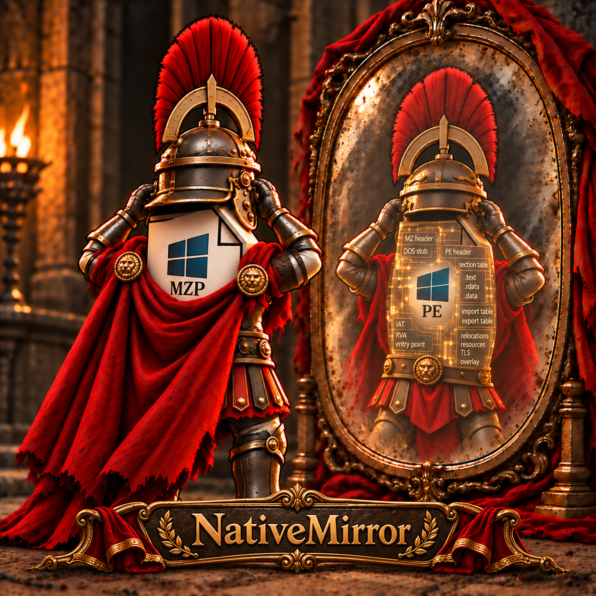

# NativeMirror

<p align="center">
  
</p>

NativeMirror is an independent Object Pascal implementation of PE-sieve functionality, adapted from [PE-sieve by hasherezade](https://github.com/hasherezade/pe-sieve). It scans process memory, detects modified or injected code, and dumps PE files.

The implementation uses Delphi-native APIs and NativePe as its PE engine. It can be used directly as a Delphi library, through its CLI, or through a PE-sieve-compatible DLL interface. All three share the same scanner core. The compatibility target is the externally observable behavior of PE-sieve 0.4.1.5; full behavioral equivalence has not been established.

## Reference versions and relocation behavior

The binary comparisons use PE-sieve **0.4.1.1** (`pe-sieve64.exe` for the Delphi investigation; the HollowsHunter fixture separately uses the bundled 0.4.1.1 DLL). NativeMirror's source reference is **0.4.1.5**.

The old 0.4.1.1 relocation code stops processing a block at a padding entry, causing false code-patch findings in the investigated Delphi modules. NativeMirror/NativePe already skip padding correctly, matching the newer 0.4.1.5 reference on this path. The upstream fix is in PE-sieve's libpeconv dependency: [commit `610a3e8f204341557dc956b7caa203e08df8d874`](https://github.com/hasherezade/libpeconv/commit/610a3e8f204341557dc956b7caa203e08df8d874).

See [the relocation analysis](DELPHI_RELOCATION_ANALYSE.md) for versions, evidence and limits. This establishes the relocation difference, not full scanner or DLL parity with 0.4.1.5; a complete 0.4.1.5 scanner was not run in that investigation.

## Requirements

- Windows and Delphi 12, with Win32 and Win64 compiler support.
- NativePe: required PE library. Place it next to NativeMirror as `../NativePe`, or adjust the Delphi search paths.
- NativeASM: optional Win64 disassembly backend. The `NativeMirrorScan.NativeAsm.dproj` project enables `USE_NATIVEASM`. Without it, NativeMirror uses the Delphi/LDE fallback. Adjust the NativeASM search path to your installation.
- Python 3 with the Windows `py` launcher: required for the DLL post-build step and Python tests. The scripts use the Python standard library.
- DUnitX: required to build the Delphi test runners. Make its units available in Delphi's search path.
- CMake and Visual Studio 2022 with C++ tools: needed only for the DLL contract tests.

Some project configurations contain local dependency paths. Check the search paths before building on another machine.

## Build

Open `NativeMirror.groupproj` in Delphi and select the required project, platform, and configuration.

| Project | Output |
| --- | --- |
| `tools/NativeMirrorScan/NativeMirrorScan.dproj` | `NativeMirrorScan.exe` |
| `tools/NativeMirrorDll/pe-sieve.dproj` | `pe-sieve.dll` |
| `tests/ScannerIntegration/NativeMirrorTestTarget.dproj` | Win64 test target |
| `tests/ScannerIntegration/NativeMirrorTestTarget32.dproj` | Win32 test target |
| `tests/ScannerIntegration/NativeMirrorScannerTests.dproj` | Win64 scanner test runner |
| `tests/HollowsHunterIntegration/NativeMirrorHollowsHunterTests.dproj` | Win64 HollowsHunter test runner |

Build the CLI and DLL for Win32 and Win64 as needed. Build both test targets before running integration tests. Build the test runners for Win64.

Outputs go to `bin/<Platform>/<Config>`. The examples below use Debug. Compiler units go to `dcu/`. Keep executables out of `tools/`.

## Run the scanner

Run these commands from the project root. Replace `1234` with the process ID to scan.

```powershell
.\bin\Win64\Debug\NativeMirrorScan.exe /help
.\bin\Win64\Debug\NativeMirrorScan.exe /pid 1234
.\bin\Win64\Debug\NativeMirrorScan.exe /pid 1234 /json /quiet /ofilter 2
.\bin\Win64\Debug\NativeMirrorScan.exe /pid 1234 /dir output
```

`/ofilter 2` disables dump output. `/dir output` selects the output directory for reports and dumps. Use the Win32 executable under `bin/Win32/Debug` when needed. Access to the target process depends on your Windows permissions.

## Use directly from Delphi

Add `src/` and its unit subdirectories, together with NativePe, to your project's search path. Call `ScanAndDump` with `TNativeMirrorOptions`. The library is compiled into your application; this usage requires neither `NativeMirrorScan.exe` nor `pe-sieve.dll`. Python is only needed for the separate DLL build and Python tests.

This console example scans PID 1234 and prints its report as JSON:

```pascal
program ScanExample;

{$APPTYPE CONSOLE}

uses
  System.JSON,
  NativeMirror.Core.Types,
  NativeMirror.Core.Options,
  NativeMirror.Core.Engine;

var
  Options: TNativeMirrorOptions;
  Report: TNativeMirrorReportEx;
  Json: TJSONObject;
begin
  Options := TNativeMirrorOptions.Default;
  Options.Pid := 1234;
  Options.Quiet := True;
  Options.OutputFilter := nmOutNoDir;
  Report := ScanAndDump(Options);
  try
    Json := Report.ToJson(Options.ResultsFilter, Options.JsonLevel);
    try
      Writeln(Json.ToJSON);
    finally
      Json.Free;
    end;
  finally
    Report.Free;
  end;
end.
```

Replace the PID with your target. `nmOutNoDir` disables report files and dumps. Inspect `Report.ErrorReport` for scan errors and `Report.ScanReport` for scan results. The caller owns the returned report and must free it.

## Files in bin

Download `pe-sieve32.exe` and `pe-sieve64.exe` from the [PE-sieve releases](https://github.com/hasherezade/pe-sieve/releases). The existing comparison scripts use the v0.4.1.1 executables. Place both in `bin/Win64/Debug`; the Win64 test scripts look for their reference scanner there. The `32` executable is the original Win32 reference, even though it is stored alongside the Win64 test tools.

A Debug setup looks like this:

```text
bin/
  Win64/Debug/
    NativeMirrorScan.exe
    pe-sieve.dll
    pe-sieve.dll.exports.json
    pe-sieve32.exe
    pe-sieve64.exe
    NativeMirrorTestTarget.exe
    NativeMirrorScannerTests.exe
    NativeMirrorHollowsHunterTests.exe
    hollows_hunter.exe
  Win32/Debug/
    NativeMirrorScan.exe
    pe-sieve.dll
    pe-sieve.dll.exports.json
    NativeMirrorTestTarget32.exe
```

NativeMirror produces the CLI, DLL, export records, targets, and test runners. PE-sieve and HollowsHunter executables are separate downloads. HollowsHunter is only needed for its integration test or manual DLL use.

## HollowsHunter: use the DLL build

Download [hollows_hunter64_dll.zip, v0.4.1.1](https://github.com/hasherezade/hollows_hunter/releases/download/v0.4.1.1/hollows_hunter64_dll.zip) from the [HollowsHunter releases](https://github.com/hasherezade/hollows_hunter/releases). Use the DLL package. With a matching host architecture and API contract, NativeMirror's finalized `pe-sieve.dll` replaces the original PE-sieve DLL used by HollowsHunter. The standalone static executable cannot use a replacement DLL. The supplied integration test covers the v0.4.1.1 Win64 DLL host.

For a manual run, copy the package's `hollows_hunter.exe` into `bin/Win64/Debug`, beside the NativeMirror-built `pe-sieve.dll`. Do not copy the package's original DLL over the NativeMirror DLL. Both the host and DLL must be Win64.

```powershell
.\bin\Win64\Debug\hollows_hunter.exe /pid 1234 /quiet /hooks /ofilter 2 /json /report 7
```

For the automated comparison, extract the unchanged original EXE and DLL from the same package into:

```text
tests/HollowsHunterIntegration/fixtures/Win64/pe-sieve-C/
  hollows_hunter.exe
  pe-sieve.dll
  manifest.json
```

Keep the existing `manifest.json`. It records the expected versions and SHA-256 hashes. The runner checks these files, copies the same host into separate reference and NativeMirror directories, and tests each DLL against controlled test processes. It does not download files or overwrite the build in `bin`.

## Why the DLL build uses Python

PE-sieve exports `PESieve_version` as a 32-bit data value. For version 0.4.1.5, that value is `0x00040105`. A caller expects the export address to point to those four bytes, rather than to a function returning the number.

The Delphi 12 compiler/linker used by this project does not export the variable directly through the `exports` clause. The DLL therefore contains the marked version value and initially exports a helper function under the required name.

After linking, the project's post-build event runs:

```powershell
py tools/NativeMirrorDll/finalize_exports.py bin/Win64/Debug/pe-sieve.dll
```

The script points the `PESieve_version` export entry at the stored number and updates the PE checksum. It leaves the scanner code and other export targets unchanged. This step runs automatically when building `pe-sieve.dproj`; a script failure fails the build.

The script also creates `pe-sieve.dll.before-version-export` as a backup and `pe-sieve.dll.exports.json` with the finalized export information and DLL hash. Keep the JSON file for the test runners. A normal DLL client only needs the finished DLL. Python is required on the build/test machine, not when using the finished DLL.

## Tests

Run commands from the project root after building the required projects and installing the reference files above.

```powershell
.\bin\Win64\Debug\NativeMirrorScannerTests.exe
.\bin\Win64\Debug\NativeMirrorHollowsHunterTests.exe
py tests/CLIOutput/test_source_contract.py
py tests/CLIOutput/test_cli_arguments.py
py tests/ParityAudit/run_module_cases.py
```

The scanner runner finds the CLI and `pe-sieve64.exe` beside itself in `bin/Win64/<Config>`. Python comparison scripts default to `bin/Win64/Debug`. Explicit overrides are available where supported:

```powershell
$env:NATIVEMIRROR_SCAN_EXE = "$PWD\bin\Win64\Debug\NativeMirrorScan.exe"
$env:PESIEVE_EXE = "$PWD\bin\Win64\Debug\pe-sieve64.exe"
$env:NATIVEMIRROR_TARGET32_EXE = "$PWD\bin\Win32\Debug\NativeMirrorTestTarget32.exe"
```

Source-contract tests require the pinned PE-sieve 0.4.1.5 source tree at `pe-sieve-master/pe-sieve-master`. C++ DLL tests use its original headers from `include/`. These reference sources are not included in the published project.

To build and run the C++ DLL contract tests:

```powershell
cmake -S tests/PeSieveDll -B parity-work/dll-contract-build-x64 -G "Visual Studio 17 2022" -A x64
cmake --build parity-work/dll-contract-build-x64 --config Debug
cmake -S tests/PeSieveDll -B parity-work/dll-contract-build-x86 -G "Visual Studio 17 2022" -A Win32
cmake --build parity-work/dll-contract-build-x86 --config Debug
py -m unittest discover -s tests/PeSieveDll -p test_version_export.py -v
py tests/PeSieveDll/run_contract.py --arch both
```

The last command needs finalized Win32 and Win64 NativeMirror DLLs, both CLI builds, and both test targets. Test artifacts are written under `parity-work/`; scanner diagnostics are written beside the scanner test runner.

The downloaded reference binaries are 0.4.1.1. Comparisons against them cover those test cases and do not establish full compatibility with the 0.4.1.5 source reference.

## Source layout

| Directory | Contents |
| --- | --- |
| `src/` | Library core, scanners, dumpers, reports, CLI parsing, and DLL API |
| `tools/NativeMirrorScan/` | CLI project files |
| `tools/NativeMirrorDll/` | DLL project and Python export finalizer |
| `tests/` | Delphi integration tests, Python comparisons, and C++ DLL callers |
| `bin/` | Local executables and DLLs |
| `dcu/` | Delphi compiler output |
| `parity-work/` | Local test runs, contract-test builds, and comparison data |
| `licenses/` | Third-party license texts |

## Credits and license

NativeMirror is an Object Pascal adaptation of [PE-sieve by hasherezade](https://github.com/hasherezade/pe-sieve), using 0.4.1.5 as its source reference. Credit for the original scanner, its algorithms, and its design belongs to hasherezade and the PE-sieve contributors. The original work remains theirs.

Copyright (c) 2026, Selahattin Erkoc: NativeMirror adaptation.
Copyright (c) 2017-2026, @hasherezade: original PE-sieve work.

NativeMirror uses the BSD 2-Clause License, the same license as PE-sieve. See [LICENSE](LICENSE), the preserved [PE-sieve license](licenses/PE-SIEVE-BSD-2-Clause.txt), and [THIRD-PARTY-NOTICES.md](THIRD-PARTY-NOTICES.md). Separate dependencies retain their own licenses.
